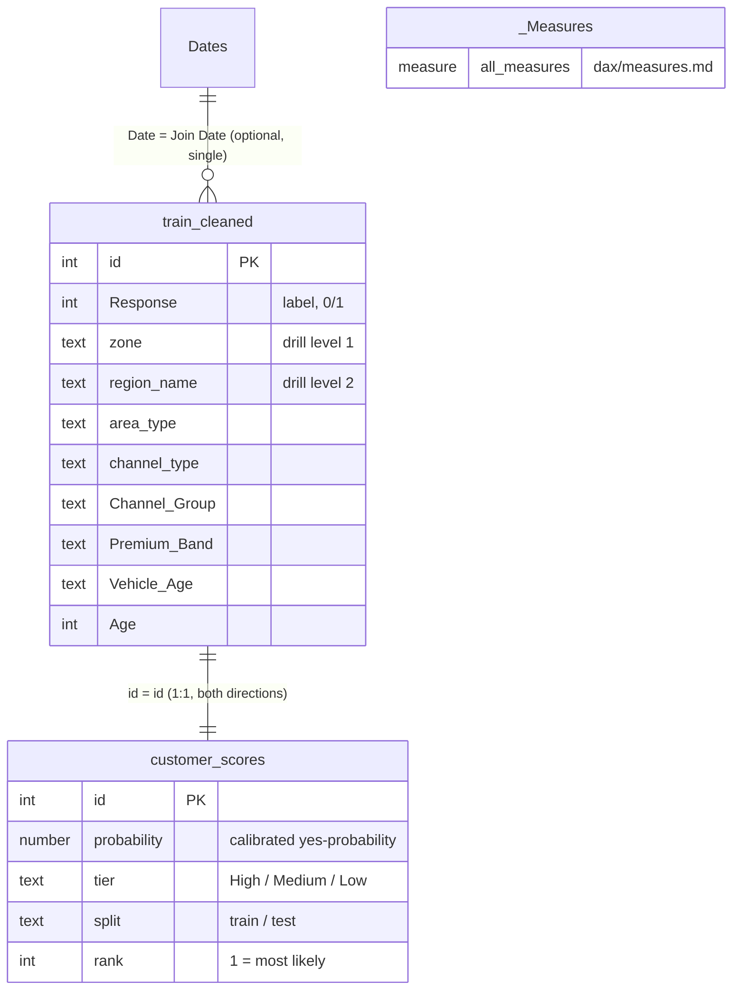

# Power BI data model

## Tables
| Table | Rows | Source | Role |
|---|---|---|---|
| `train_cleaned` | 381,109 | Power Query (SQLite + reference merges) | customers and their attributes |
| `customer_scores` | 381,109 | `data/processed/customer_scores.csv` via `powerquery/customer_scores.m` | the model's output |
| `_Measures` | 0 | Enter data | holds the measures only |
| `region_map`, `channel_map` | — | Power Query | **load disabled**. Their columns were already merged into `train_cleaned`, and loading them too would leave two unconnected tables in the model |

## The relationship
- `train_cleaned[id]` → `customer_scores[id]`, **One to one**. Power BI forces cross-filter direction **Both** on 1:1.
- Both directions are needed:
  - tier → customers: `Customers` counts `train_cleaned` rows, and the tier slicer lives in `customer_scores`.
  - region → scores: `Expected Responders` sums `customer_scores[probability]`, and the zone/region filter lives in `train_cleaned`.
- If Power BI proposes **Many to one** instead, an `id` is duplicated or typed differently on one side. Stop and check both are Whole Number with 381,109 distinct values.

### Why two tables instead of merging the scores in Power Query?
Merging would work, and with a 1:1 relationship it's arguably simpler. They're kept apart on purpose. The scores come from a different system (Python) on a different schedule. In a real team the model is re-run and the CSV swapped without touching the customer query. A merge would tie the two refreshes together.

### Star schema note
A textbook star has one fact table surrounded by dimensions. Here the region/channel dimensions were **flattened into** `train_cleaned` back in Phase 3 (the merge). That's a common, legitimate choice for a single-fact model this size, at the cost of repeating text values. With more fact tables (e.g. a campaign-calls table), you'd load `region_map` / `channel_map` as real dimensions and relate them instead.

## Column settings
- **Don't summarize** (Column tools → Summarization → Don't summarize): `id` (both tables), `Region_Code`, `Policy_Sales_Channel`, `Driving_License`, `Previously_Insured`, `Response`, `Vintage`, `Age`, `rank`, `probability`. These are codes, flags or row-level values. Every aggregation goes through an explicit measure, so a stray "Sum of Region_Code" can't appear.
- **Hide** `customer_scores[id]` (use `train_cleaned[id]`) and the three `… Sort` columns.
- **Hierarchy** on `train_cleaned`: right-click `zone` → Create hierarchy, then drag `region_name` into it. Name it `Geography`.
- **Hierarchy**: `channel_type` → `Channel Group`, name it `Channel`.
